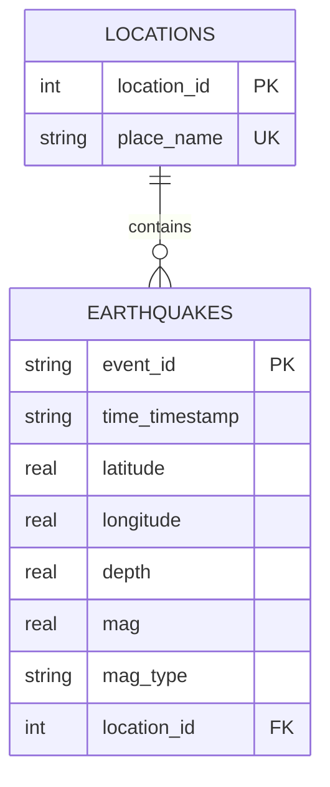
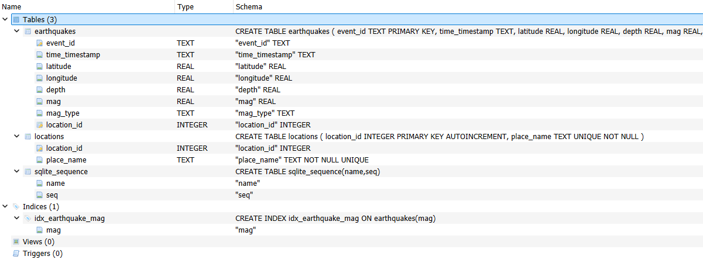

# Public Seismic Data Pipeline & Analytics

An end-to-end pipeline built in Python that streams real-time seismic event datasets from a public web server, structures them into an indexed local SQLite relational database, and executes analytical intelligence reporting.

## Design & Architecture

### 1. Data Source Selection
- **Source:** United States Geological Survey (USGS) Earthquake Hazards Feed (`https://earthquake.usgs.gov/fdsnws/event/1/query?format=csv`)
- **Justification:** This official government dataset is public and unauthenticated, meeting the requirement to ingest data without logging in or using API keys. The raw global CSV logging format dynamically pushes out over 12 MB of rich transactional metrics, meeting the 10 MB structural data footprint constraint.

### 2. Relational Schema Structure
The database (`earthquakes.db`) implements a clean, normalized relational star-schema design to guarantee storage efficiency:
- `locations`: Dimension table tracking geographical description attributes with unique constraints to avoid string redundancy.
- `earthquakes`: Fact table managing explicit unique event records, timestamps, magnitude metrics, and depths.
- **Optimization:** Includes a dedicated index on the `mag` column to accelerate heavy analytical aggregation and ordering queries.

### Visual Entity-Relationship (ER) Diagram



#### Database Architecture Diagram


### 3. Pipeline Design & Idempotency
- **Extraction:** Downloads the raw comma-separated values stream dynamically using `requests` straight into memory buffers.
- **Idempotency:** Driven by a strict primary key constraint linked to the record's unique USGS identifier (`event_id`). Running the pipeline multiple times safely skips duplicate entries and refreshes data without cluttering metrics.
- **Compliance:** Per the instructions, the raw data layout is never saved in Git; it is streamed entirely on-demand at runtime.

---

## Getting Started

### Prerequisites
- Python 3.12+
- Internet Connection (Unauthenticated)

### 1. Installation & Environment Setup
Clone this repository and create a Python virtual environment to isolate project packages:

```bash
git clone <your-repo-url>
cd usgs-earthquake-pipeline

# Initialize and activate the virtual environment sandbox
python -m venv venv
venv\Scripts\activate   # On Mac/Linux use: source venv/bin/activate

# Install required dependencies
pip install -r requirements.txt
```

### 2. Execute the Master Pipeline
Run the entire process from schema migrations and data ingestion to automated business intelligence calculations using the single orchestrator command:

```bash
python main.py
```

### 3. Running the Test Suite
To verify table generation rules and data ingestion idempotency behavior, run the automated framework checks:

```bash
pytest
```

---

## Insights & Reports
When the script finishes running, it outputs a multi-layered matrix addressing 4 core research metrics:
1. **Question 1 (Pure SQL):** Locates the top 5 highest magnitude earthquakes globally to spot immediate high-risk zones.
2. **Question 2 (Pure SQL):** Compiles count totals and averages grouped across distinct mechanical measurement scale options (`mag_type`).
3. **Question 3 (Python Tooling):** Generates an overall magnitude distribution curve chart saved directly onto the hard drive as `earthquake_magnitude_distribution.png`.
4. **Question 4 (Python Tooling):** Compiles an analytical Pearson scatter plot correlation matrix mapping earthquake depth metrics against their resulting magnitudes, saved as `depth_vs_magnitude.png`.

---

## Upstream Guardrails & Rate Limits

During the implementation and testing of Phase C, the following upstream API constraints and data thresholds were discovered and resolved:

1. **Per-Query Record Ceilings:** The official USGS FDSN Query API enforces a strict global maximum threshold cap of 20,000 records per individual request. Exceeding this ceiling causes the server to truncate the stream mid-transmission and append plain-text HTML error indicators to the response payload.
2. **Mitigation (Paging & Slicing):** To bypass this barrier and hit the mandatory 10 MB raw data volume requirement, the ingestion engine (`pipeline.py`) was adjusted to chunk historical timelines into six 30-day windows (`limit=20000`). This safely aggregates **13.35 MB raw text payload** in memory entirely beneath the server's single-query caps.
3. **Rate Limiting Protection:** Back-to-back requests can trigger temporary `429 (Too Many Requests)` rate-limiting window blocks on the public endpoint. The ingestion pipeline implements a deliberate `time.sleep(0.5)` throttle pause between chronological window calls to ensure polite, uninterrupted network extraction.