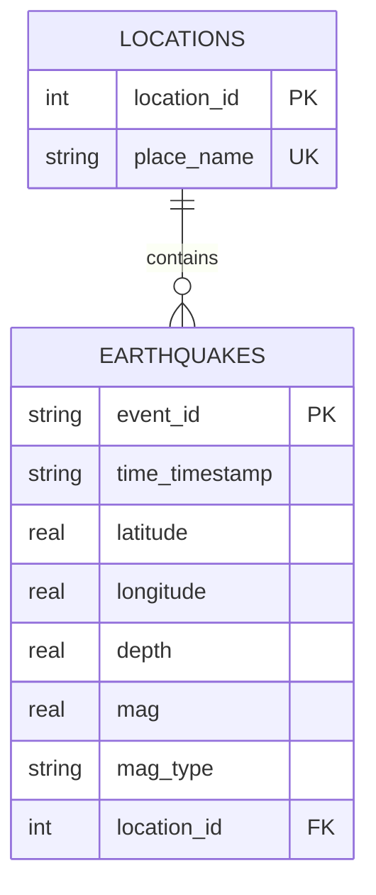

# Public Seismic Data Pipeline & Analytics

An end-to-end Python batch pipeline that downloads recent earthquake records from
the public USGS API, stores validated events in SQLite, and generates SQL
summaries, charts, and an HTML report. It runs on demand; it is not a continuous
real-time stream.

## Design & Architecture

### 1. Data Source Selection
- **Source:** United States Geological Survey (USGS) [FDSN Event Web Service](https://earthquake.usgs.gov/fdsnws/event/1/), queried in CSV format.
- **Access and volume:** The dataset is public and requires no login or API key. Download volume varies with seismic activity and API results. The pipeline prints the combined response size; it does not enforce or guarantee a minimum of 10 MB.

### 2. Relational Schema Structure
The database (`earthquakes.db`) separates event measurements from location descriptions using the tables in [schema.sql](schema.sql):
- `locations`: Dimension table tracking geographical description attributes with unique constraints to avoid string redundancy.
- `earthquakes`: Fact table managing explicit unique event records, timestamps, magnitude metrics, and depths.
- **Index:** An index on `mag` can assist magnitude lookups and ordering; actual query performance depends on the query and data volume.

### Visual Entity-Relationship (ER) Diagram



### 3. Pipeline Design & Idempotency
- **Extraction:** [pipeline.py](pipeline.py) requests six adjacent 30-day UTC windows ending at the current time, covering 180 days. Responses and parsed records are held in memory; raw CSV files are not written.
- **Idempotency:** `event_id` is the primary key. `INSERT OR IGNORE` skips existing events, including duplicates at window boundaries. Repeated runs add new events but do not update previously stored events when USGS revises their values. Old database records are not automatically deleted.
- **Reliability:** Requests use a 30-second timeout and at most three attempts. Request exceptions and HTTP 429/500/502/503/504 responses are retried with 1- and 2-second delays; other non-200 statuses fail immediately. A 0.5-second pause separates windows.
- **Completeness and transactions:** If any window fails, has malformed CSV or missing required headers, or reaches 20,000 rows, ingestion aborts before inserting data. Database inserts run in one transaction and roll back on a database error. There is no automatic pagination or window subdivision.
- **Row quality:** Required identifiers, parseable timestamps, finite numeric values, and coordinate bounds are checked. Invalid rows are rejected and counted rather than failing the entire window. Missing optional magnitude/depth values remain null; a missing place becomes `Unknown`. Event times must include a timezone offset (naive timestamps are rejected) and are stored as UTC ISO-8601 strings with millisecond precision, such as `2026-10-31T13:10:08.987Z`. Rows already stored before this change keep their original text.

---

## Getting Started

### Prerequisites
- Python 3.12 is the documented baseline and the version configured in CI. Newer Python versions are not covered by the current CI workflow.
- Internet access for dependency installation and live USGS ingestion (no API key).
- Docker is optional; Docker Desktop is needed for the container commands on Windows.
- The automated tests are offline; they do not contact USGS or open a browser.

### 1. Installation & Environment Setup
Clone this repository and create a Python virtual environment to isolate project packages:

```powershell
git clone https://github.com/bleverrett/usgs-earthquake-pipeline.git
cd usgs-earthquake-pipeline

# Use the documented Python baseline on Windows.
py -3.12 -m venv .venv
.\.venv\Scripts\python.exe -m pip install --require-hashes -r requirements.lock
.\.venv\Scripts\python.exe -m pip check
```

Run commands from the repository root unless using absolute paths.
On Linux/macOS, use `python3 -m venv .venv` with Python 3.12, then
`.venv/bin/python -m pip install --require-hashes -r requirements.lock` and
`.venv/bin/python -m pip check`. Activation is optional.

[`requirements.lock`](requirements.lock) pins direct and transitive dependencies
with SHA-256 hashes and platform markers. It includes the existing notebook and
test packages plus coverage tooling. The documented local setup, CI workflow,
and Docker image install project dependencies from this lock. CI separately
upgrades pip without pinning its version, so the installer version itself is
not fixed across runs.

### 2. Execute the Master Pipeline
Run schema initialization, data ingestion, and analysis using [main.py](main.py).
Schema initialization creates missing tables and indexes; it does not migrate
existing schema definitions.

```powershell
.\.venv\Scripts\python.exe main.py
```

On Linux/macOS use `.venv/bin/python main.py`. In a headless environment, prefix
that command with `MPLBACKEND=Agg`; on Windows set `$env:MPLBACKEND = "Agg"`
before running it. Database and report assets are written alongside the project
source, so that directory must be writable. Reports overwrite existing files.

**Legacy launcher:** [run.sh](run.sh) is not the recommended setup path. It must
run from the repository root, creates `venv`, installs unpinned
[requirements.txt](requirements.txt), and unnecessarily requires `API_KEY`.
The Python pipeline itself does not use this variable. Use the explicit locked
installation and Python commands above instead.

### 3. Running the Test Suite
Run schema, ingestion, reporting, rollback, and complete workflow checks:

```powershell
$env:MPLBACKEND = "Agg"
.\.venv\Scripts\python.exe -m pytest
.\.venv\Scripts\python.exe -m pytest --cov=pipeline --cov=analysis --cov=main --cov-branch --cov-report=term-missing --cov-report=xml --cov-fail-under=90
```

On Linux/macOS, use `MPLBACKEND=Agg .venv/bin/python -m pytest` and the same
coverage arguments. `pytest.ini` selects `tests` and uses `.pytest-tmp` for
temporary files; that directory is recreated on each run and must not hold
anything you need to retain. HTTP calls, pauses, and browser opening are replaced
in tests. Databases and generated reports are isolated under temporary folders.

The [CI workflow](.github/workflows/ci.yml) runs on pushes and pull requests
targeting `main`. It uses Ubuntu 24.04 and Python 3.12, upgrades pip without
pinning the pip version, installs project dependencies from
`requirements.lock` with hash verification, and runs `pytest`. Its cache key
still hashes `requirements.txt`, not `requirements.lock`. This is the project's
intended CI scope: it does not enforce the 90% coverage gate, test other
Python/OS combinations, or build/test Docker images. The coverage command above
is a local quality check, not an existing CI guarantee.
Check actual workflow results on GitHub; configuration alone does not establish
that a remote run passed.

### 4. Docker Build, Test, and Run

```powershell
docker build -t usgs-earthquake-pipeline .
docker run --rm usgs-earthquake-pipeline python --version
docker run --rm usgs-earthquake-pipeline python -m pip check
docker run --rm --network none usgs-earthquake-pipeline python -m pytest --cov=pipeline --cov=analysis --cov=main --cov-branch --cov-fail-under=90
```

Live ingestion requires networking. Keep the completed container until you have
copied its database and report assets:

```powershell
docker run --name usgs-run usgs-earthquake-pipeline
New-Item -ItemType Directory -Force docker-output
docker cp usgs-run:/app/earthquakes.db .\docker-output\earthquakes.db
docker cp usgs-run:/app/project_report.html .\docker-output\project_report.html
docker cp usgs-run:/app/earthquake_magnitude_distribution.png .\docker-output\earthquake_magnitude_distribution.png
docker cp usgs-run:/app/depth_vs_magnitude.png .\docker-output\depth_vs_magnitude.png
docker rm usgs-run
```

Open the copied HTML with both PNGs in the same folder. The Docker context
excludes existing databases, generated assets, virtual environments, and caches,
so the image starts without stale local data. Docker uses the Python 3.12 slim
image and a noninteractive plotting backend; the base-image tag can receive
upstream updates and is not an immutable image digest. The dependency versions
are locked, but the base image is not pinned by digest, so this is not a fully
bit-for-bit reproducible image build.

### 5. Updating the Dependency Lock

Edit `requirements.txt` or `requirements-dev.txt`, then regenerate the universal
lock using Python 3.12 in a separate tooling environment:

```powershell
py -3.12 -m venv .venv-lock
.\.venv-lock\Scripts\python.exe -m pip install uv==0.9.5
.\.venv-lock\Scripts\uv.exe pip compile requirements-dev.txt --python-version 3.12 --universal --generate-hashes --output-file requirements.lock
```

Review changes, reinstall in a clean `.venv`, run `pip check` and the coverage
command, and run the Docker checks above locally if Docker is available.
Also check the existing CI test results; container and coverage checks are not
currently automated in CI.
Universal resolution retains OS-specific notebook dependencies instead of
forcing Windows-only packages into Linux images.

---

## Insights & Reports
When analysis runs against a nonempty database, [analysis.py](analysis.py)
generates a console summary and report assets:
1. **Question 1 (Pure SQL):** Locates the five highest-magnitude earthquakes from the latest six calendar months.
2. **Question 2 (Pure SQL):** Summarizes recent seismic activity using approximate coordinate-based regional bounding boxes; these categories are not authoritative fault or plate-boundary polygons.
3. **Question 3 (Python Tooling):** Generates a magnitude distribution chart for the latest six calendar months, saved as `earthquake_magnitude_distribution.png`.
4. **Question 4 (Python Tooling):** Compiles a depth-versus-magnitude scatter plot and Pearson correlation for events from the same six-month period, saved as `depth_vs_magnitude.png`.
- **Report packaging:** `project_report.html` contains the tables and styling but references the two PNG files; images are not embedded. Keep all three files together when copying or sharing the report. The application attempts to open the report in a browser; manual opening may be necessary in headless environments.
- **Analytics scope:** All four queries use SQLite's UTC lower bound `datetime('now', '-6 months')`; there is no explicit upper bound excluding future-dated records. Six calendar months is not exactly 180 days, so a newly populated database may not cover the full reporting interval. Reports reflect only records actually stored and eligible for each query, not guaranteed complete USGS coverage.
- **Interpretation:** Highest magnitude does not by itself establish the most dangerous location. Geographic categories are approximate coordinate boxes, not authoritative fault/plate boundaries. Depth/magnitude correlation is descriptive, not causal; missing or undefined correlation is shown as `N/A`.
- **Empty data and failures:** An empty database produces a console error and no new report, but analysis returns normally and the master workflow can still print success. Existing report files are not removed, so inspect console output and output modification times before treating a report as current. Exceptions propagated from workflow stages produce a nonzero exit status.

---

## Upstream Guardrails & Rate Limits

The implementation requests `limit=20000` and treats a response with 20,000 or
more rows as potentially incomplete. Six fixed windows reduce request size but
do not guarantee staying below that threshold. Throttling and bounded retries
reduce transient failures but do not guarantee uninterrupted access.

| Symptom | Current behavior and next step |
|---|---|
| Record-limit error | No ingestion records are written. Reduce the window duration and increase the window count in `pipeline.py` if retaining 180-day coverage, or implement finer slicing before retrying. These are source constants, not CLI options. |
| Request failure after three attempts | Check connectivity and the reported HTTP status. Retry later for upstream throttling/outages; ingestion does not write partial windows. |
| Tk/Tcl or display errors while plotting/testing | Set `MPLBACKEND=Agg` before starting Python, as in the test instructions. |
| Charts missing after copying HTML | Copy both generated PNGs into the same directory as the HTML file. |
| No report or an old report | Inspect the console for an empty database or stage failure and check file timestamps. Old artifacts are not cleared automatically. |

These are implementation guarantees and limitations, not a live-service
availability claim. Download size, current API behavior, and remote CI status
must be verified separately when required.