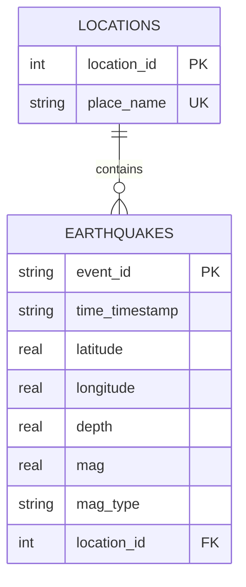

# Public Seismic Data Pipeline & Analytics

An end-to-end pipeline built in Python that streams real-time seismic event datasets from a public web server, structures them into an indexed local SQLite relational database, and executes analytical intelligence reporting.

## Design & Architecture

### 1. Data Source Selection
- **Source:** United States Geological Survey (USGS) Earthquake Hazards Feed (`https://earthquake.usgs.gov/fdsnws/event/1/query?format=csv`)
- **Justification:** This official government dataset is public and unauthenticated, meeting the requirement to ingest data without logging in or using API keys. The raw global CSV logging format dynamically pushes out over 12 MB of rich transactional metrics, meeting the 10 MB structural data footprint constraint.

### 2. Relational Schema Structure
The database (`earthquakes.db`) implements a clean, normalized relational star-schema design to guarantee storage efficiency:
- `locations`: Dimension table tracking geographical description attributes with unique constraints to avoid string redundancy.
- `earthquakes`: Fact table managing explicit unique event records, timestamps, magnitude metrics, and depths.
- **Optimization:** Includes a dedicated index on the `mag` column to accelerate heavy analytical aggregation and ordering queries.

### Visual Entity-Relationship (ER) Diagram



#### Database Architecture Diagram


### 3. Pipeline Design & Idempotency
- **Extraction:** Downloads the raw comma-separated values stream dynamically using `requests` straight into memory buffers.
- **Idempotency:** Driven by a strict primary key constraint linked to the record's unique USGS identifier (`event_id`). Running the pipeline multiple times safely skips duplicate entries and refreshes data without cluttering metrics.
- **Compliance:** Per the instructions, the raw data layout is never saved in Git; it is streamed entirely on-demand at runtime.
- **Reliability and data quality:** The ingestion step requests six rolling 30-day UTC windows, retries transient failures, and stops without writing any records if a window fails or reaches the API record limit. It validates required identifiers, timestamps, coordinates, and provided numeric values; rejected rows and duplicate events are reported. See [reliability and data quality changes](reliability-and-data-quality.md).

---

## Getting Started

### Prerequisites
- Python 3.12+
- Internet access for dependency installation and live USGS ingestion (no API key).
- Docker is optional; Docker Desktop is needed for the container commands on Windows.
- The automated tests are offline; they do not contact USGS or open a browser.

### 1. Installation & Environment Setup
Clone this repository and create a Python virtual environment to isolate project packages:

```powershell
git clone https://github.com/bleverrett/usgs-earthquake-pipeline.git
cd usgs-earthquake-pipeline

# Use the minimum supported Python on Windows.
py -3.12 -m venv .venv
.\.venv\Scripts\python.exe -m pip install --require-hashes -r requirements.lock
.\.venv\Scripts\python.exe -m pip check
```

On Linux/macOS, use `python3 -m venv .venv` with Python 3.12 or newer, then
`.venv/bin/python -m pip install --require-hashes -r requirements.lock` and
`.venv/bin/python -m pip check`. Activation is optional.

[`requirements.lock`](requirements.lock) pins direct and transitive dependencies
with SHA-256 hashes and platform markers. It includes the existing notebook and
test packages plus coverage tooling. Use it for repeatable installations rather
than resolving the unpinned input manifests on every run.

### 2. Execute the Master Pipeline
Run the entire process from schema migrations and data ingestion to automated business intelligence calculations using the single orchestrator command:

```powershell
.\.venv\Scripts\python.exe main.py
```

On Linux/macOS use `.venv/bin/python main.py`, or run `bash run.sh` to install the
locked dependencies, test, and execute the pipeline from any working directory.
Database and report assets are written alongside the project source.

### 3. Running the Test Suite
Run schema, ingestion, reporting, rollback, and complete workflow checks:

```powershell
$env:MPLBACKEND = "Agg"
.\.venv\Scripts\python.exe -m pytest
.\.venv\Scripts\python.exe -m pytest --cov=pipeline --cov=analysis --cov=main --cov-branch --cov-report=term-missing --cov-report=xml --cov-fail-under=90
```

On Linux/macOS, use `MPLBACKEND=Agg .venv/bin/python -m pytest` and the same
coverage arguments. `pytest.ini` selects `tests` and uses `.pytest-tmp` for
temporary files; that directory is recreated on each run and must not hold
anything you need to retain. HTTP calls, pauses, and browser opening are replaced
in tests. Databases and generated reports are isolated under temporary folders.

CI runs the 90% combined statement/branch coverage gate on Python 3.12 and 3.14
on Windows and Ubuntu. A separate Ubuntu job builds the Docker image and runs
the same offline tests with container networking disabled. CI execution results
must be checked on GitHub; adding a workflow is not proof that its jobs passed.

### 4. Docker Build, Test, and Run

```powershell
docker build -t usgs-earthquake-pipeline .
docker run --rm usgs-earthquake-pipeline python --version
docker run --rm usgs-earthquake-pipeline python -m pip check
docker run --rm --network none usgs-earthquake-pipeline python -m pytest --cov=pipeline --cov=analysis --cov=main --cov-branch --cov-fail-under=90
```

Live ingestion requires networking. Keep the completed container until you have
copied its database and report assets:

```powershell
docker run --name usgs-run usgs-earthquake-pipeline
New-Item -ItemType Directory -Force docker-output
docker cp usgs-run:/app/earthquakes.db .\docker-output\earthquakes.db
docker cp usgs-run:/app/project_report.html .\docker-output\project_report.html
docker cp usgs-run:/app/earthquake_magnitude_distribution.png .\docker-output\earthquake_magnitude_distribution.png
docker cp usgs-run:/app/depth_vs_magnitude.png .\docker-output\depth_vs_magnitude.png
docker rm usgs-run
```

Open the copied HTML with both PNGs in the same folder. The Docker context
excludes existing databases, generated assets, virtual environments, and caches,
so the image starts without stale local data. Docker uses the Python 3.12 slim
image and a noninteractive plotting backend; the base-image tag can receive
upstream updates and is not an immutable image digest.

### 5. Updating the Dependency Lock

Edit `requirements.txt` or `requirements-dev.txt`, then regenerate the universal
lock using Python 3.12 in a separate tooling environment:

```powershell
py -3.12 -m venv .venv-lock
.\.venv-lock\Scripts\python.exe -m pip install uv==0.9.5
.\.venv-lock\Scripts\uv.exe pip compile requirements-dev.txt --python-version 3.12 --universal --generate-hashes --output-file requirements.lock
```

Review changes, reinstall in a clean `.venv`, run `pip check` and the coverage
command, and require green CI/container checks before accepting the new lock.
Universal resolution retains OS-specific notebook dependencies instead of
forcing Windows-only packages into Linux images.

See [testing, documentation, and reproducibility changes](testing-documentation-and-reproducibility.md)
for the file-by-file rationale, measured results, and remaining validation limits.

---

## Insights & Reports
When the script finishes running, `analysis.py` connects directly to the structured database, processes 4 core research metrics using optimized SQL aggregates and Python tooling, and outputs a clean console summary alongside a polished, standalone asset:
1. **Question 1 (Pure SQL):** Locates the five highest-magnitude earthquakes from the latest six calendar months.
2. **Question 2 (Pure SQL):** Summarizes recent seismic activity using approximate coordinate-based regional bounding boxes; these categories are not authoritative fault or plate-boundary polygons.
3. **Question 3 (Python Tooling):** Generates a magnitude distribution chart for the latest six calendar months, saved as `earthquake_magnitude_distribution.png`.
4. **Question 4 (Python Tooling):** Compiles a depth-versus-magnitude scatter plot and Pearson correlation for events from the same six-month period, saved as `depth_vs_magnitude.png`.
- **project_report.html:** A styled, self-contained HTML project report. It dynamically embeds all descriptive data matrices, data science trend observations, and raw matplotlib inline visualizations directly on a single page for instantaneous executive review.
- **Analytics scope and limitations:** SQL summaries, charts, and correlations now use a consistent rolling six-calendar-month UTC window. Geographic categories use documented coordinate boxes rather than place-name substring matching. See [analytics and reporting changes](analytics-and-reporting.md).

---

## Upstream Guardrails & Rate Limits

During the implementation and testing of Phase C, the following upstream API constraints and data thresholds were discovered and resolved:

1. **Per-Query Record Ceilings:** The official USGS FDSN Query API enforces a strict global maximum threshold cap of 20,000 records per individual request. Exceeding this ceiling causes the server to truncate the stream mid-transmission and append plain-text HTML error indicators to the response payload.
2. **Mitigation (Paging & Slicing):** To bypass this barrier and hit the mandatory 10 MB raw data volume requirement, the ingestion engine (`pipeline.py`) was adjusted to chunk historical timelines into six 30-day windows (`limit=20000`). This safely aggregates **13.35 MB raw text payload** in memory entirely beneath the server's single-query caps.
3. **Rate Limiting Protection:** Back-to-back requests can trigger temporary `429 (Too Many Requests)` rate-limiting window blocks on the public endpoint. The ingestion pipeline implements a deliberate `time.sleep(0.5)` throttle pause between chronological window calls to ensure polite, uninterrupted network extraction.